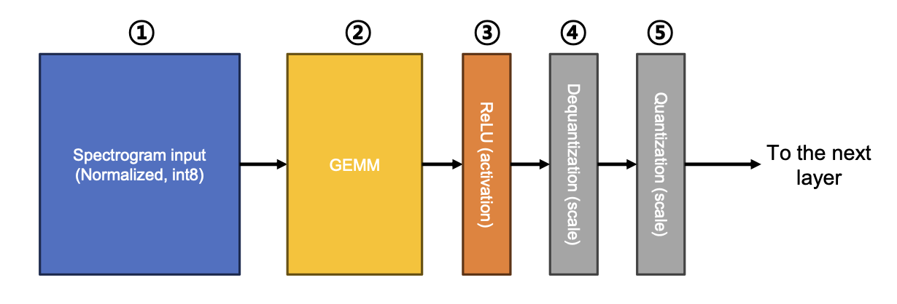
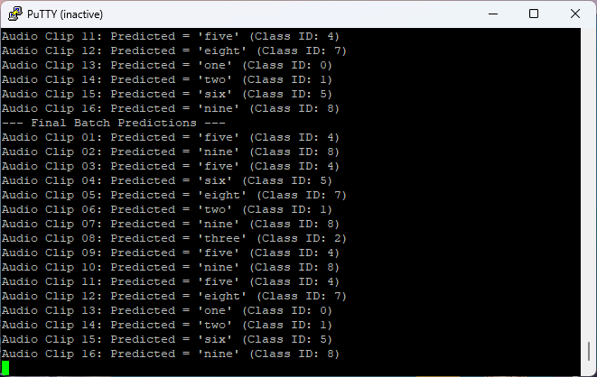

# Final

## 요약 정리

**구현해야 했던 것은 무엇인가?** - input으로 어떤 음성 데이터가 들어온다. 이 음성 데이터는 spcetrogram으로 변환되어 flatten되고, 이것이 16개 batch되어 들어간다. (미리 타일링 됨) 

이런 걸 4번 반복해서 사용해야 한다. 그니까 우리가 구현해야할 건...

.png)

바로 이것이다. 여기서 BRAM을 제외한 전부를 구현하면 된다. PE는 int8 input을 받아 곱해서(int16) 더한걸(int32) 출력하는 구조이다. Post Processor는 relu와 requantization, rounding, saturating을 적용하는 구조이다. Sequencer도 구현해야 한다. Skewer는 PE array에 input을 공급하는 역할을 한다. 시퀀서가 잘 이해가 안가네…

***보고서에 들어가야 하는 내용은 무엇인가?*** - 시스톨릭 어레이의 작동 원리, 타일링에 대해 기재.  어떻게 하드웨어에 맞춰서 설계했는지? material description에 대해 기재. 그니까 BRAM에 서 어떻게 데이터를 읽고 쓰는지를 설명하면 될듯. 코드 설명 부분은 당연히 포함이다. 그리고 어려웠던 점... 은 codex를 읽고 알아보자. + 시퀀서의 3중 for 문을 어떻게 구현했는지.

## 팀원 분의 보고서 요약

이 보고서는 **Google Speech Command 기반 4-layer quantized MLP 추론을 16×16 systolic array 하드웨어 가속기로 구현하는 과정**을 설명합니다. 내용은 입력 spectrogram을 `int8` feature로 변환해 16개 batch로 처리하는 workload 설명, `GEMM → ReLU → requantization → saturation`으로 이어지는 정수 연산 파이프라인, 2D systolic array와 tiling 이론, BRAM 중심 datapath, PE array, skewer, post-processor, controller/FSM, BRAM 주소 생성과 layer transition, NumPy reference와 testbench를 이용한 검증 흐름까지 포함하고 있습니다. 특히 현재 보고서는 아키텍처와 구현 설명은 꽤 충실하지만, **Results와 Discussion이 아직 TBD 상태이므로 실제 시뮬레이션 결과, 보드 실행 캡처, 최종 output 확인 결과, 구현 중 어려웠던 점 또는 실패 원인 분석**을 추가해야 합니다. 또한 과제 PDF에서 요구한 필수 항목인 **sequencer가 3중 for-loop 구조를 FSM으로 어떻게 제어했는지**, 그리고 **동작 사진, 즉 캡처와 보드 사진**도 반드시 보강해야 합니다.

## 260607 추가할 것

- 일단 오늘은 discussion에서 힘들었던점, 시퀀서의 구조가 어떻게 되어있는지를 설명할 것…. (함수화, argument)
- 코드에 주석을 달 것.

## 260608 학교 갔다 실험함

- 공지사항) 시퀀서의 작동 과정을 서술하기
    - 추가로 discussion 내용 보완하기
    - 코드 주석 달기 맞다 > 달았음!
    - 실물 사진 추가하기
    - testbench 결과는 넣지 말 것 (waveform)

### result 부분

한국어로 먼저 쓰기, 

- 일단 run synthesis, run implementation and generate bitstream 과정을 거쳐 보드에 이를 올리고 결과를 지켜보았다.
    - s1 버튼을 누르고 s2 버튼을 눌렀다. 그 뒤 출력되는 결과를 보았다.
- 실제 audio clip이 나타내는 true label과 조금 다르게 관측된 것이 있었는데, 이는 모델이 잘못 예측한 것으로 해석할 수 있다. (이걸 어떻게 이쁘게 쓰지?)

### discussion 부분

- 어려웠던 점) 

가장 크게 막혔던 부분은 **RTL 구조를 명세에서 실제 동작 가능한 데이터 흐름으로 바꾸는 것**이었습니다. 단순히 PE 하나를 만드는 것과 달리, 16x16 systolic array에서는 입력 A/B가 어느 cycle에 어느 PE에 도착해야 하는지, 누산값이 언제 유효해지는지, flush를 몇 cycle 해야 하는지 맞추는 게 까다로웠습니다. 중간에 C11 expected 50, got 18 같은 오류가 난 것도 이 타이밍 정렬 문제가 원인이었습니다.

두 번째는 **BRAM 주소와 128-bit packing 방식**이었습니다. AXI에서는 32-bit 단위로 접근하지만 내부 BRAM은 128-bit word 단위라서, addr[17:4]가 BRAM row 주소가 되고 addr[3:2]가 32-bit lane이 되는 구조였습니다. 그래서 0x2880 같은 RTL 주소가 Vitis에서는 0x28800 byte offset이 되는 식으로 변환해야 했고, 이 부분이 헷갈리기 쉬웠습니다.

세 번째는 **layer를 이어 붙이는 CONTROL FSM**이었습니다. 처음에는 layer1 tile만 검증했고, 이후 layer2, layer3, layer4를 이어 붙이면서 input/output base address, weight base address, k-tile 수, out-tile 수, scaler를 layer별로 바꾸도록 확장했습니다. 여기서 실수하면 이전 layer output을 다음 layer input으로 제대로 못 읽거나, 결과를 엉뚱한 BRAM 위치에 쓰게 됩니다.

네 번째는 **post-processing timing closure**였습니다. 처음에는 ReLU, 32x32 multiply, rounding, saturation을 한 클럭에 처리해서 implementation에서 WNS가 약 -9ns까지 깨졌습니다. 이건 기능 시뮬레이션에서는 통과해도 FPGA에서는 동작 보장이 안 되는 문제였습니다. 그래서 POST_PROCESSOR를 여러 stage로 pipeline화해서 timing을 통과시켰고, 이후 DSP pipeline 경고도 줄이기 위해 곱셈 뒤 register stage를 추가했습니다.

### 수정된 점

- 보고서에 code snippets 좀 더 추가.
- Results, Discussion 내용 보완 및 실패 부분 삭제.
- sequencer 설명을 Controller overview 부분에 좀 더 보완.
